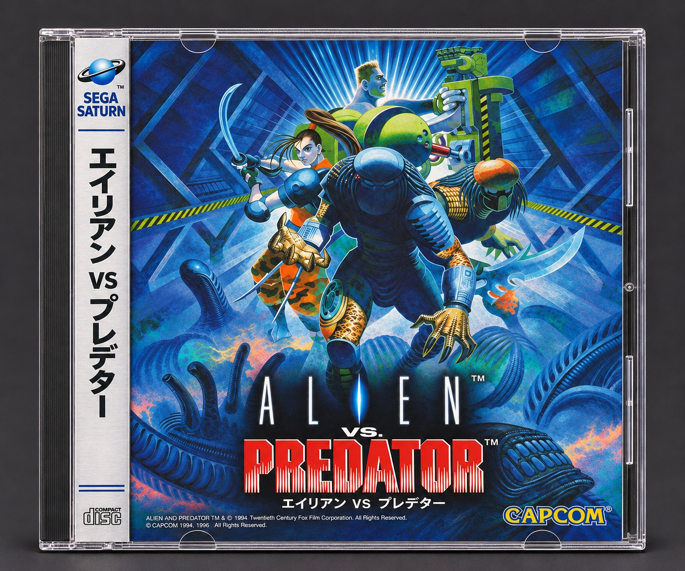
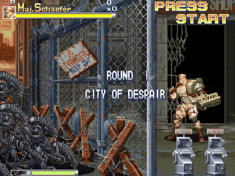
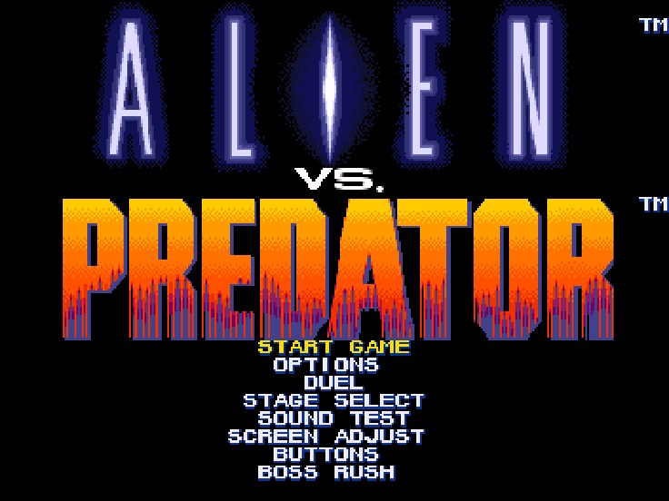
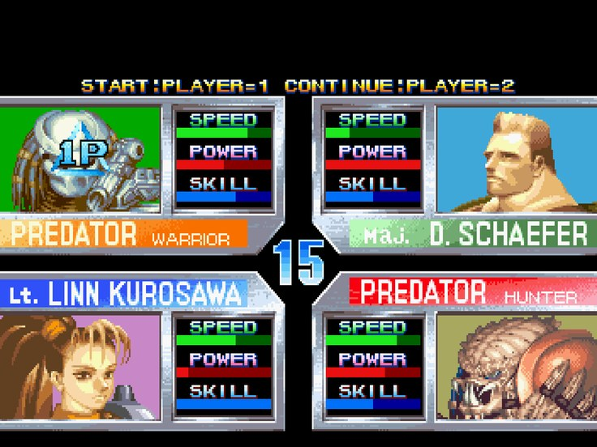
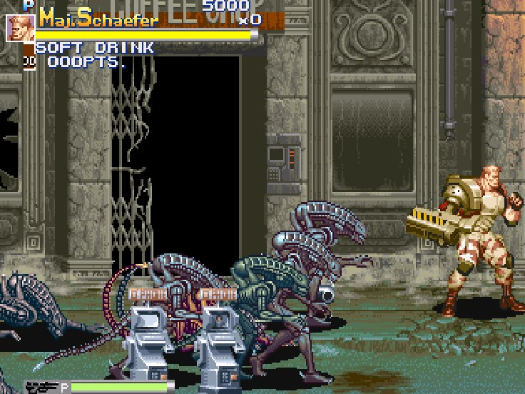

# AvP Saturn

Alien vs. Predator, Capcom's 1994 arcade brawler, running natively on the Sega Saturn.



*Cover art by the AvP Saturn production team.*

**[Download the current v0.1.3 beta](https://github.com/lamb2k/avpsaturn/releases/tag/v0.1.3-test4)** ·
**[Play in your browser](https://avp.retronetplay.com)** ·
[Earlier release notes](docs/RELEASE_NOTES_v0.1.2.md)

- **New in v0.1.3:** loading feedback and clearer boot errors, restored Predator hit sounds and Warrior grab
  sprites, and fixes for the Razor Claws foreground and Linn’s head-bounce freeze. The beta passed headless
  tests. Hardware retests are pending.
- **What works:** the whole arcade game for one or two players, all four characters, music and sound effects, and a
  home menu with Versus, Boss Rush, Stage Select and Options. Wolverine is in as a bonus character.
- **What you need:** an NTSC Saturn with the 4 MB RAM cartridge (Fenrir, a burned CD-R, or a SAROO, which supplies
  the cart itself), or an emulator that supports it. The disc fits on an 80-minute CD-R.
- **What's rough:** it slows down in crowded fights on a real Saturn. Getting it to full speed is the next job.
- **Coming next:** full speed on real hardware, and menus styled after Capcom's own Saturn releases.



**[Watch a 47-second clip, with sound (MP4)](docs/media/avp-saturn-beta.mp4)**

| Title menu | Character select | Round 1 |
|---|---|---|
|  |  |  |

Found a bug? [Open an issue](https://github.com/lamb2k/avpsaturn/issues) with the stage and what was happening.

## About the project

AvP Saturn is a fan preservation project. The goal is to keep Alien vs. Predator playable as real software on the
Saturn, not as an emulator running on top of it. The game belongs to its rights holders (see [NOTICE.md](NOTICE.md)),
so only build from a ROM set you're entitled to use.

The port is based on the US arcade release (MAME set `avspu`, "Alien vs. Predator (USA 940520)") and needs the
Saturn's 4 MB RAM cartridge. The general tools and playbook for porting CPS2 games to the Saturn live in their own
repo, [lamb2k/cps2saturn](https://github.com/lamb2k/cps2saturn).

## How it works

- **MAME is the reference.** We record what the arcade does in MAME and check the Saturn version against it.
- **The game logic comes from the arcade.** The 68000 code is translated to C, then cleaned up into readable C one
  function at a time, checking each step against the original.
- **The hardware side is written for the Saturn.** Sprites go through VDP1, backgrounds through VDP2, sound through
  the SCSP, music plays as CD audio, and the 4 MB cartridge holds the graphics that don't fit in main memory.

The background research behind this approach is in
[docs/research/CPS2_TO_SATURN_RESET.md](docs/research/CPS2_TO_SATURN_RESET.md), with its
[source ledger](docs/research/CPS2_TO_SATURN_SOURCE_LEDGER.md) and
[evidence ledger](docs/research/CPS2_TO_SATURN_EVIDENCE_LEDGER.md). Some of it predates the current method.

## For developers

The rest of this page is working notes for anyone building from source. Fair warning: the build is still a
developer setup, not a one-command affair yet.

### Project documents

- [AGENTS.md](AGENTS.md): how the decompilation work is run
- [docs/STATUS.md](docs/STATUS.md): where things stand
- [docs/BACKLOG.md](docs/BACKLOG.md): what's left to do
- [docs/GOAL.md](docs/GOAL.md)
- [docs/ARCHITECTURE.md](docs/ARCHITECTURE.md)
- [docs/TEST_PLAN.md](docs/TEST_PLAN.md)
- [docs/HARDWARE_TEST.md](docs/HARDWARE_TEST.md)
- [docs/AGENT_HANDOFF.md](docs/AGENT_HANDOFF.md)
- [project_state.yaml](project_state.yaml)

Older plans are kept for reference under `docs/archive/`.

### Toolchain

- Jo Engine commit `556d081146211b6a1cfa6591d70f9487d406758b`, plus `engine-patches/joengine-4bpp-sprites.patch`
- SH-ELF GCC 9.3.0
- MAME 0.289, pinned under `.deps/mame/mame0289`
- Yaba Sanshiro `1.20.37-2986eb`
- Python 3, and GCC under WSL for the generators and host tests

`setup_engine.ps1` and `setup_emulator.ps1` install the engine and emulator. Run them in a separate working copy.

### Building and testing

The beta disc is built with `saturn/rt/build.py`, with its feature switches passed in through `KERNEL_CFLAGS`,
`BOOT_CFLAGS` and `AUDIO_CFLAGS`. A documented one-command recipe for it is still to come.

The older test lanes are still available (see [docs/TEST_PLAN.md](docs/TEST_PLAN.md)):

```powershell
.\verify.ps1 -Lane Fast
.\verify.ps1 -Lane Oracle
.\verify.ps1 -Lane Target -TargetProfile EncounterTest -BuildOnly
.\verify.ps1 -Lane Full
```

`Full` regenerates tracked files, so run it in a separate working copy. Emulator results don't replace the checks on
real hardware in [docs/HARDWARE_TEST.md](docs/HARDWARE_TEST.md).

### What not to commit

No ROMs, keys, disc images, ISO/cue files, raw captures, memory dumps, disassembly bytes or generated game graphics
and audio. The only screenshots and video in the repo are the release media under `docs/images/release/` and
`docs/media/`. Code, schemas, hash and count manifests, tests and documentation are all fine.
