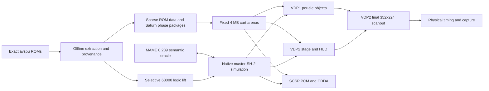

# Active architecture

This is a concise operational view. The complete authoritative decision, alternatives, evidence, and stop conditions are in `docs/research/CPS2_TO_SATURN_RESET.md`.

## Development boundary

The architecture is reached through the interactive salvage-and-promotion loop
in `docs/PARITY_PLAN.md`. Existing mixed-runtime systems are isolated and
tested before replacement, then promoted behind `port_v2` interfaces. Lab and
prototype results inform reuse decisions but do not advance production parity
or physical capability gates.

## Runtime boundaries

- Master SH-2 owns one deterministic simulation tick, typed actor state, input sampling, lifted behavior calls, collision/damage, stage/camera state, and semantic render/audio events.
- Slave SH-2 is deferred until profiling finds a separable job with measured benefit.
- VDP1 starts with one ordered 16x16 4bpp normal-sprite command per emitted CPS-2 tile. Physical draw-end decides whether a bounded composite/hybrid path is needed.
- VDP2 owns scroll3, scroll2, source-proven foreground/HUD needs, CRAM, priority, line tables where traced, and final scanout.
- The 32 Mbit cart uses fixed phase arenas with manifests, canaries, and high-water. No generalized runtime cache/streamer precedes proof.
- CD data reads and CDDA have explicit, measured ownership. All G0 slice assets are resident before music begins.
- SCSP PCM carries bounded effects/voices; CDDA carries long music. Exact QSound DSP reconstruction is deferred.

## Data and code boundaries

- Decode instructions only from the MAME opcode-fetch image and data only from the declared program/data or asset region.
- Keep original tables as sorted sparse source-address spans when that improves differential comparison.
- Convert graphics, maps, palettes, and audio offline into phase packages with target ROM hashes, source offsets, tool pins, output hashes, schema, consumer, and lifetime.
- Lift only the transitive writer set required by the selected gameplay slice. CPS-2 register writes become semantic native events, not literal CPS-2 hardware emulation.

## Parked paths

The authored capability model, capture-derived holds, RP4 strip fixture, adapted point/range collision, and disabled CDDA path remain recoverable regression fixtures until replacements pass. RP8 frontend work, per-object cache, linked-list framework, slave-SH-2 work, broad static recompilation, and a general Capcom engine are parked.

Historical architecture text is under `docs/archive/pre-reset-2026-08-20/` and is not active guidance.
