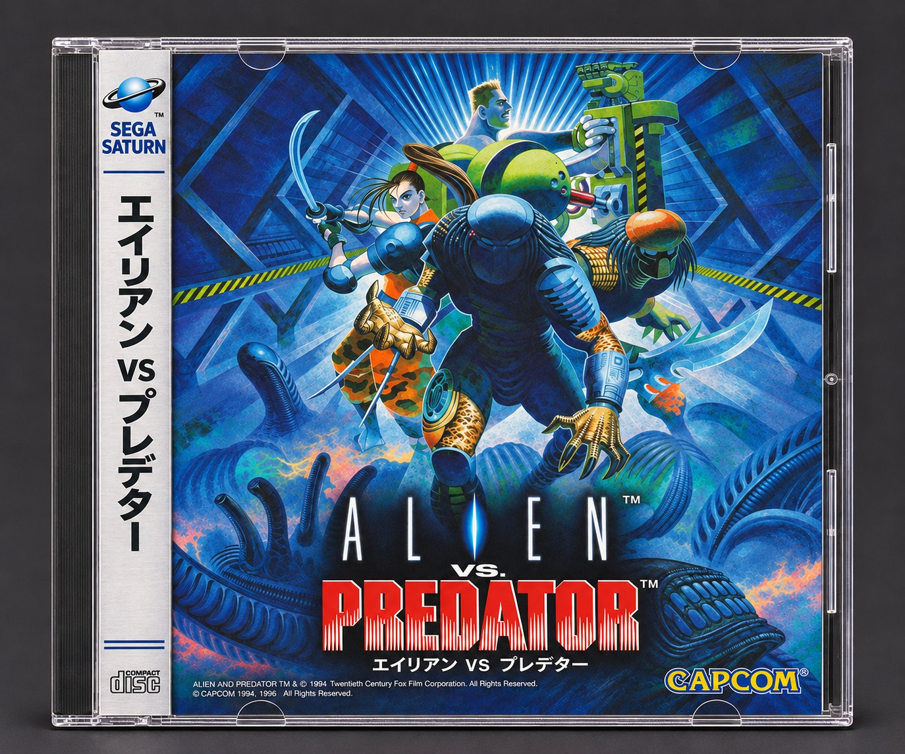
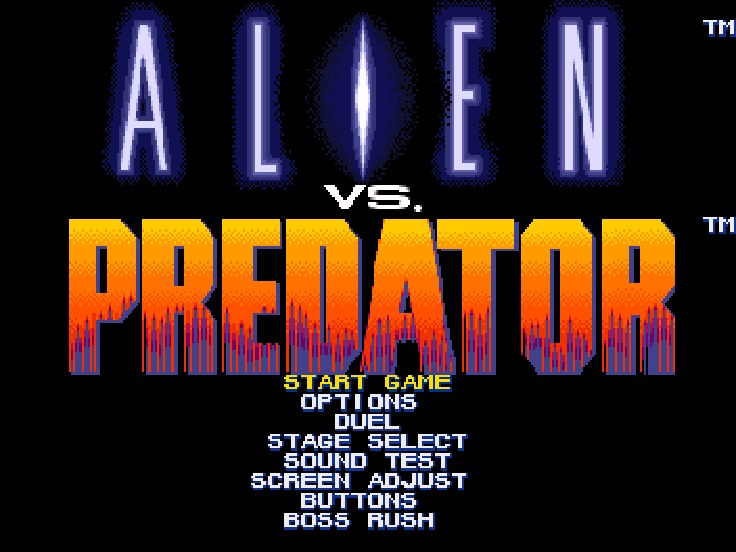
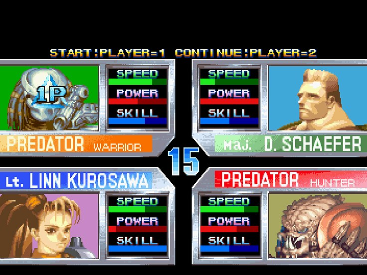
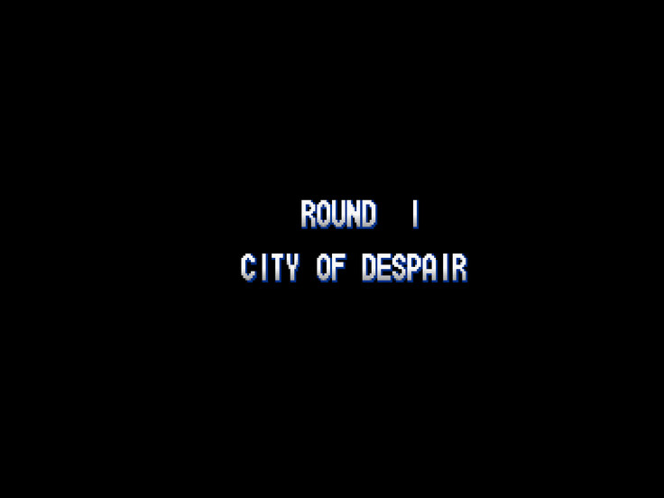

# AvP Saturn: Beta (v0.1.0-beta)

Capcom's Alien vs. Predator (CPS2 arcade, 1994) as a native Sega Saturn game. It is not an emulator running on the
Saturn: the game's own logic is rebuilt for the Saturn's chips. This is the first beta, for players who want to try
it and report what's wrong.

## Watch it

**[Watch the beta capture (MP4)](media/avp-saturn-beta.mp4)**: title, attract intro, character select and the
Round 1 Coffee Shop fight.

| Title menu | Attract intro | Character select |
|---|---|---|
|  |  |  |
| **Round 1: City of Despair** | **Coffee Shop** | **Round 1 fight** |
|  |  |  |

*Emulator captures (Yaba) of the beta disc, build fix7c3.*

## What's in it

- **The whole arcade game,** from the first street to the ending, for one or two players.
- **All four arcade characters:** Dutch Schaefer, Linn Kurosawa, Predator Warrior and Predator Hunter.
- **Music and sound:** CD music from the story screens on, and the arcade's sound effects.
- **Home menu:**
  - Arcade, Stage Select and Boss Rush.
  - Versus: two players duel while aliens drop in.
  - Options: lives, button config, sound test, screen adjust, bonus characters.
  - Pause and quit to title.
- **Bonus character:** Wolverine. Finish the game to unlock him, or switch him on in Options.
- **Saves** your options to the Saturn's backup memory.

## What you need

- An NTSC Sega Saturn with the **4 MB RAM cartridge**, plus an optical drive emulator or a burned disc.
- Or an emulator with the 4 MB cartridge, such as Yaba Sanshiro or Ymir.
- The disc is 63.5 minutes long, so it fits on a 74- or 80-minute CD-R.

## Status

- **Runs on a real Saturn.** Earlier builds of this line were played on a console from a Fenrir drive. The fixes in
  this build were checked on emulators.
- **Slows down in crowded fights** on a real Saturn. Speed work is next.

## Known issues

- After Wolverine joins or continues mid-stage, the health bar still shows Dutch's name and face.
- A few rarely played sound effects are still missing from some stages.
- Expect rough edges. Please report what looks, sounds or feels wrong, with the stage and the moment.

## Coming next

- Full speed in crowded fights on a real Saturn.
- Menus laid out like Capcom's own Saturn ports.

## Rights

Intended for software preservation. Alien vs. Predator belongs to its rights holders; see
[NOTICE.md](../NOTICE.md). Build or play only from a ROM set you are authorized to use. The general CPS2-to-Saturn
tools live in [lamb2k/cps2saturn](https://github.com/lamb2k/cps2saturn).
