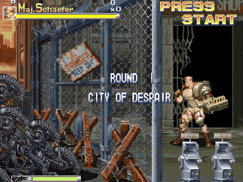
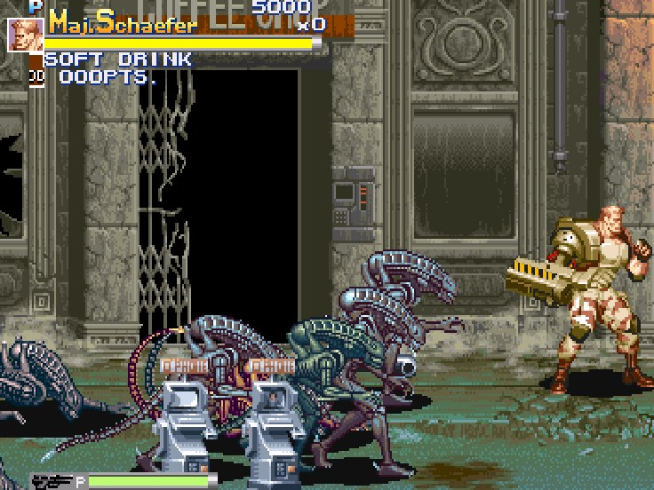
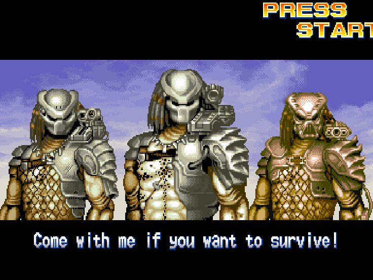
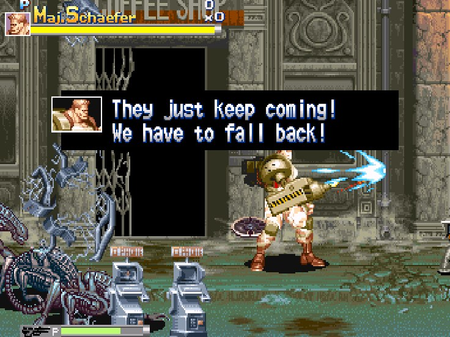

# AvP Saturn — Beta (v0.1.0-beta)

Alien vs. Predator (Capcom CPS2 arcade, 1994) running as a native Sega Saturn
game. This is the first beta: an early test copy for players who want to try it
and report problems.

**Play it in a browser:** https://avp.retronetplay.com (emulator build, no download).

## Watch it

**[Watch the 52-second beta capture (MP4)](media/avp-saturn-beta.mp4)**: title, attract intro, character select and the Round 1 Coffee Shop fight. Silent.

## Screenshots

| Title menu | Attract intro | Character select |
|---|---|---|
|  |  |  |
| **Round 1: City of Despair** | **Coffee Shop** | **Round 1 fight** |
|  |  |  |

*Captured from the browser test build (Build duel-1, image a04b2d43ff54) on 2026-11-14.*

## What's in it

- The arcade game, with all four characters to pick from.
- A home menu with a Smash-style Duel, Boss Rush, Stage Select and Options.

## What you need

- A Sega Saturn (NTSC) with the **4 MB RAM cartridge**, or an emulator that
  supports it.

## Status

- **Beta.** Tested on emulators only. It has not run on a real Saturn yet.
- Expect rough edges and missing pieces. Please report what looks or feels wrong.

## Coming next

- Menus laid out like Capcom's own Saturn ports.
- A NOW LOADING indicator and a music player.
- A disc that fits on an 80-minute CD-R.

## Rights

Intended for software preservation. Alien vs. Predator belongs to its rights
holders; see [NOTICE.md](../NOTICE.md). Build or play only from a ROM set you
are authorized to use.
