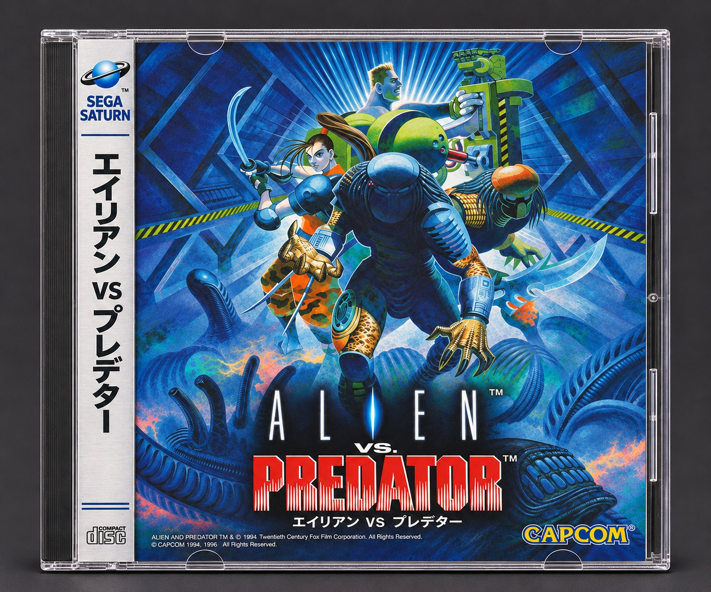
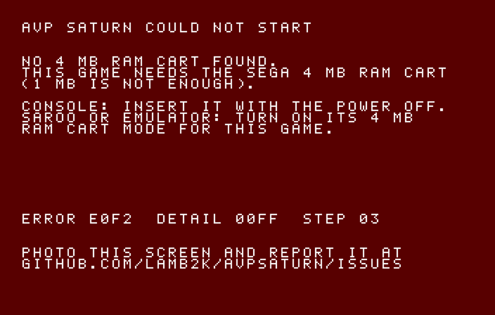

A small fix release for the v0.1.0 beta. The game itself is unchanged; only the start-up code is new.

## What's fixed

- **SAROO:** the game should now start on SAROO. It was overwriting the memory-cart timing SAROO sets up for its
  built-in 4 MB RAM cart. It now leaves that timing alone. Nothing changes on a console with a real cart, on
  Fenrir, or in emulators.
- **Clear error screen:** if the game can't start, it now says why in plain words instead of showing coloured bars.
  It covers a missing or faulty 4 MB RAM cart, disc read errors and crashes, with an error code to quote in a report.
- **Disc ID:** the disc now has its own product ID, `AVPSAT01`, so drive emulators can keep per-game settings for it.

*The new error screen with no cart inserted. Captured in Ymir from this disc.*

## Download

Grab `avp_saturn_beta_v0.1.1.zip` below, unzip it, and load the `.cue` file.

You'll need one of these:

- An NTSC Saturn with the 4 MB RAM cartridge, running the disc from an optical drive emulator (we test on a Fenrir)
  or a burned CD-R (63.5 minutes, so a 74 or 80 minute blank works).
- A SAROO. It provides the 4 MB RAM cart itself; start the game from the SAROO menu.
- An emulator that supports the 4 MB cartridge, such as Yaba Sanshiro or Ymir.

No Saturn handy? Play it in your browser at https://avp.retronetplay.com.

## Known issues

- Slowdown in crowded fights on real hardware. This is the main thing we're working on.
- Speckled graphics during loading and pause, and a garbled Predator grab and punch, reported on Fenrir. We're
  looking into both.
- A handful of rarely heard sound effects are missing in some stages.
- The SAROO fix comes from reading SAROO's firmware source. We haven't run it on a SAROO ourselves yet, so please
  tell us how it goes.

If something looks, sounds or plays wrong, [open an issue](https://github.com/lamb2k/avpsaturn/issues). If the game
stops on the error screen, a photo of it is the most useful thing you can send.

## Legal

AvP Saturn is a fan preservation project. Alien vs. Predator and its characters belong to their owners; see
[NOTICE.md](https://github.com/lamb2k/avpsaturn/blob/release/v0.1.1-beta/NOTICE.md). Only build from a ROM set you're
entitled to use. Our general CPS2-to-Saturn tools are in [lamb2k/cps2saturn](https://github.com/lamb2k/cps2saturn).
