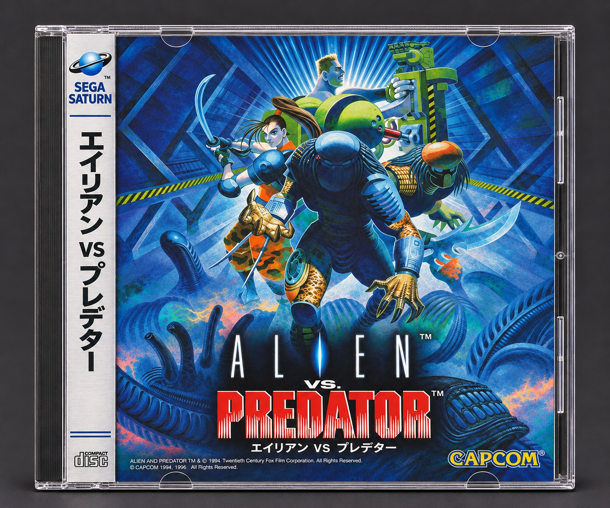

A fix release for the graphics problems reported on Fenrir. Tested on a real Saturn with a Fenrir.

## What's fixed

- **Loading and pause screens:** no more speckled or garbled graphics. The menu font and colours are now read
  carefully from the 4 MB RAM cart, the colours are only rewritten when they change, and the NOW LOADING screen
  waits until it is actually on screen before the load starts.
- **Predator grab and punch:** the animation draws correctly again.
- **Cart check at start-up:** the game tests the 4 MB RAM cart at its fast setting every time it starts, in a
  fraction of a second. A cart that passes keeps full speed. A cart that doesn't is switched to the slower standard
  setting instead of showing glitches. If that happens, one of the start-up bars turns yellow. No reset is needed
  either way.

Everything from v0.1.1 is still here: the SAROO fix, the plain-words error screen and the `AVPSAT01` disc ID.

## Download

Grab `avp_saturn_beta_v0.1.2.zip` below, unzip it, and load the `.cue` file.

You'll need one of these:

- An NTSC Saturn with the 4 MB RAM cartridge, running the disc from an optical drive emulator (we test on a Fenrir)
  or a burned CD-R (63.5 minutes, so a 74 or 80 minute blank works).
- A SAROO. It provides the 4 MB RAM cart itself; start the game from the SAROO menu.
- An emulator that supports the 4 MB cartridge, such as Yaba Sanshiro or Ymir.

No Saturn handy? Play it in your browser at https://avp.retronetplay.com.

## Known issues

- Slowdown in crowded fights on real hardware. This is the main thing we're working on.
- A handful of rarely heard sound effects are missing in some stages.
- The SAROO fix comes from reading SAROO's firmware source. We haven't run it on a SAROO ourselves yet, so please
  tell us how it goes.

If something looks, sounds or plays wrong, [open an issue](https://github.com/lamb2k/avpsaturn/issues). If the game
stops on the error screen, or a start-up bar turns yellow, a photo is the most useful thing you can send.

## Legal

AvP Saturn is a fan preservation project. Alien vs. Predator and its characters belong to their owners; see
[NOTICE.md](https://github.com/lamb2k/avpsaturn/blob/release/v0.1.2-beta/NOTICE.md). Only build from a ROM set you're
entitled to use. Our general CPS2-to-Saturn tools are in [lamb2k/cps2saturn](https://github.com/lamb2k/cps2saturn).
