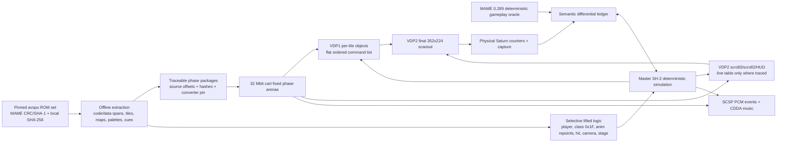

# CPS-2 to Sega Saturn architecture reset

Historical architecture audit, not current execution instructions. The pause,
frontier, estimates and next steps below describe 2026-08-20 only. Current R7C
work follows project_state.yaml, PARITY_PLAN and the active REIMPLEMENT-13 card.
Preserve the source/architecture/platform constraints; do not restart completed
Oracle, SPEC or salvage work because of this historical recommendation.

Audit date: 2026-08-20

Implementation target: `avspu` only

Repository baseline inspected: `codex/avp-master-plan` at `e79f666c865b096192aa102137db1cfdfad6c321`

Decision state: architecture recommendation complete; broad implementation remains paused

## Executive recommendation

Use approach E: a title-specific hybrid native port. Keep MAME 0.289 as the deterministic semantic oracle; extract and normalize only the AvP data needed by a bounded gameplay slice; preserve useful ROM tables in sparse, address-traceable spans; selectively lift the few 68000 routines that own player action, class `0x1F` enemy state, animation-pointer changes, hit resolution, camera, and stage progression; implement the machine-facing layer as native Saturn code.

For the first slice, use one 16x16 4bpp VDP1 normal-sprite command per emitted CPS-2 tile. That is already the runtime's actual path (`main.c:1956-2017`), matches MAME's blocked-object expansion (`.deps/mame-source/cps2.cpp:865-998`), and is the only measured method in the rights-owned MSHvSF Saturn reference (`../AvPSaturnCapabilityTest-MSHvSF/docs/MSHVSF_SATURN_ARCHITECTURE.md:66-105`). It is a baseline, not a performance conclusion: the AvP corpus peaks at 909 tiles in one frame (`data/avsp_sprite_demand.json:3-29`). A physical VDP1 draw-end and frame-time probe is the gate. Build a load-time composite or hybrid cache only if that measurement fails.

Do not continue RP8 presentation work first. The current project has strong extraction, oracle, palette, scene, residency, and render-fixture infrastructure, but the playable runtime is still mostly authored C behavior (`capability_model.c:148-309`, `capability_model.c:402-734`, `capability_model.c:828-1008`), the ROM actor bridge covers only street-alien WALK/ATTACK (`main.c:1660-1744`), and stage CDDA is disabled (`main.c:3209-3225`). The next proof must be a gameplay-valid hardware slice, not another title/menu scene.

## Exact target and fidelity contract

### Target identity

| Field | Pinned value | Evidence |
|---|---|---|
| Game | Alien vs. Predator | MAME 0.289 `-listxml avspu` |
| Set | `avspu` | `AGENTS.md:25-33`; verified local set |
| Description | `Alien vs. Predator (USA 940520)` | `.deps/mame-source/cps2.cpp:12600` |
| Region/revision | USA, 1994-05-20 revision | Set description and US program ROM names |
| Parent / clone | clone `avspu`, parent and `romof` `avsp` | MAME 0.289 list XML |
| Main CPU | Motorola 68000 program/data space plus CPS-2 decrypted opcode-fetch space | `.deps/mame-source/cps2.cpp:1316-1318`, `1743`, `10931` |
| Arcade video | 384x224 visible, 59.637405 Hz; 8 MHz pixel clock, 512x262 total | MAME 0.289 list XML; `.deps/mame-source/cps1.h` video constants |
| Port output | NTSC Saturn, 352x224, 32 Mbit expansion RAM required | `build/hardware_release_manifest.txt`; `docs/GOAL.md:1-3` |

The complete ROM, derived-space, and tool hashes are in [CPS2_TO_SATURN_SOURCE_LEDGER.md](CPS2_TO_SATURN_SOURCE_LEDGER.md). `mshvsf` is not an implementation target. Its clean reference worktree at `dc5d3ea81ac8751b312234bac95d51370151a8e5` supplies one-title evidence about an original Capcom Saturn conversion; it is not an AvP specification and must stay isolated.

### Fidelity contract

| Dimension | Required contract | Evidence and allowed compromise |
|---|---|---|
| Gameplay and timing | The same deterministic input sequence must produce the same state transitions, action IDs, positions/velocities, spawn decisions, health changes, and encounter boundary at source-frame cadence. | Compare semantic state every source frame. Saturn may schedule work differently, but it may not change game-visible results. |
| Collision and hit behavior | Preserve source hit/hurt selector choice, signed box geometry, eligibility/latch rules, damage, hit-stop/reaction, and KO transitions. | Current C predicate is proven over captures, but the runtime attacker reach remains adapted (`capability_model.c:343-399`). No point/range approximation is acceptable in the proof slice. |
| Animation | Preserve action-to-program selection, record duration, jumps, facing, emitted tile content/order, palette, and pose cadence. | Sparse ROM record spans are acceptable. External HIT/KO pointer writers must be translated before acceptance. |
| Stage and raster | Preserve visible scroll2/scroll3 content, camera coupling, source priority classes, palette changes, HUD, and any line-scroll used by the selected slice. | Use VDP2-native planes/tables. Captured whole-layer strips are diagnostic fixtures only. |
| Audio | Preserve event timing and identity; use SCSP PCM for short effects and CDDA for long-form music. | Exact QSound spatial/DSP output is a title-specific compromise unless a listening/capture test justifies more. Silent or disabled music is not acceptable. MAME documents QSound as a sixteen-channel sample player with DSP command semantics in [its implementation](https://github.com/mamedev/mame/blob/mame0289/src/devices/sound/qsound.cpp). |
| Resolution and framing | Keep a 384x224 source coordinate space and emit a 352x224 Saturn aperture without non-uniform sprite scaling. Define the 16-pixel-per-side crop/camera policy in the slice oracle. | Full 384-column simultaneous visibility is not promised. Existing 384-to-352 fit math is adapted, not yet canonical (`capability_model.c:75-108`; `docs/archive/pre-reset-2026-08-20/ARCHITECTURE.pre-reset.md:101-115`). |
| Input latency | One digital-pad sample per simulation tick, no extra queued frame versus the MAME input ledger. | Measure input-to-state and input-to-photon on hardware; emulator screenshots do not prove it. |
| Loading | No data read may interrupt a declared CDDA interval. All G0 slice assets are resident before music starts. | Short scene transitions are acceptable; invisible mid-combat stalls are not. The Saturn extended-RAM manual permits CPU reads/writes but has asymmetric DMA constraints ([Technical Bulletin 47](https://antime.kapsi.fi/sega/files/ST-TECH-47.pdf)). |
| Compromises | Title-specific extraction, sparse ROM spans, 352-column crop, phase-fixed arenas, and a pragmatic QSound-to-CDDA/PCM mapping are acceptable when documented and tested. | No general CPS-2 emulator, no general Capcom engine, no captured gameplay video/screenshot substitution, and no behavior approximation hidden as parity. |

## Repository state

- The live branch is `codex/avp-master-plan` at RP7 commit `e79f666`; recent commits contain RP5 residency, RP6 scene manifest, and RP7 row-scroll classification.
- The worktree was deliberately dirty before this audit: 44 tracked files were modified and numerous private diagnostic scripts and local notes were untracked. Nothing was reset, restored, stashed, switched, broadly staged, or committed.
- The pre-reset status documents drifted behind the repository. `docs/archive/pre-reset-2026-08-20/AGENT_HANDOFF.pre-reset.md:23-26` labels RP4 in progress while later sections record RP5/RP6/RP7 results (`:119-187`). `README.pre-reset.md:13-25`, `ARCHITECTURE.pre-reset.md:273-303`, and `TEST_PLAN.pre-reset.md:199-205` in the same archive also describe older RP4 gaps.
- At the audited baseline, Capability Gate 1 remained 0/7 and full-game acceptance remained 0/9 (`docs/archive/pre-reset-2026-08-20/PARITY_PLAN.pre-reset.md:47-60`). Shared-primitives tests and presentation checks had not advanced those gates. The reset replacement is `docs/PARITY_PLAN.md`.
- The last ISO is `debug-encounter-test`, not `normal-release`. Its manifest says `profile=encounter-test`; therefore its hashes are diagnostic artifacts, not a release candidate.
- The pinned build stack is Jo Engine `556d081...` plus a private 4bpp/audio-status patch (`setup_engine.ps1:3-59`), SH-ELF GCC 9.3.0, and Yaba Sanshiro `1.20.37-2986eb` with a pinned archive hash (`setup_emulator.ps1:5-32`).
- An isolated shadow-copy run of `test.ps1` completed with exit 0 on 2026-08-20. It did not write into the live repository. It proves deterministic host models and retained readbacks, not a normal release, audible output, or physical timing.

## Current architecture

The repository is a mixed prototype, not a translated game runtime.

1. Offline tools drive MAME, inspect ROM/data/opcode spaces, recover actor layout, animation records, object emission, graphics tiles, frontend composition, stage scroll, scene groups, palettes, audio events, and route demand.
2. Generated sparse C headers and Saturn CD bundles preserve some ROM-derived values. `avsp_emit.h:54-114` is a useful original-address span view; the current corpus verifier records 18,025 exact eligible objects, 961 source game omissions, and zero emission mismatches (`data/avsp_object_corpus_verification.json:106-112`).
3. A native SH-2 executable loads through a small ISO boot loader, uses the 4 MB cart for large assets, Jo/SGL for platform services, VDP1 for actors/objects, VDP2 for planes/final composition, and SCSP/CDDA for audio.
4. The runtime's actual ROM actor renderer expands each CPS object into tiles and calls `jo_sprite_draw3D` per tile (`main.c:1956-2017`). Its comment calling this a per-object consumer is inaccurate (`main.c:1853-1858`).
5. The gameplay model initializes authored actors, authored waves, fixed timings, and authored enemy AI (`capability_model.c:148-309`, `589-747`, `828-949`). Only one enemy class/action subset is connected to ROM actor data (`main.c:1660-1744`).
6. Thirteen capture-derived RLE presentation/route holds are still loaded and selected by authored timers (`main.c:1030-1078`). These are distinct from the ROM-derived fitted title/select pages and object schedules.
7. The RP4 street fixture validates two pre-fitted VDP2 planes and captured objects over a bounded interval (`main.c:2021-2030`). It is not the production stage runtime.
8. Audio assets and a disc-read ownership guard exist, but the stage CDDA call is commented out while the guard state is set (`main.c:3209-3225`). Audible music is therefore not implemented in the inspected runtime.

## Claim and evidence audit

Evidence labels: **HW** physical Saturn; **ME** more than one emulator; **1E** one Saturn emulator; **MT** deterministic MAME trace; **SA** static analysis; **IP** implemented but not exercised; **PL** planned; **X** contradicted; **U** unknown.

| Hypothesis | Support | Counter-evidence / unknown | Status | Decision |
|---|---|---|---|---|
| One VDP1 command per CPS object is preferable | Lower nominal count: peak 86 objects versus 909 tiles. | Current code and MAME both expand to tiles; MSHvSF uses per-tile; no AvP object-composite hardware result. | **X/U** | Park. Do not build before the physical tile baseline fails. |
| Per-tile rendering is viable | Current path, host tile tests, RP4 emulator readback, and one original Saturn port support it. | Worst-case AvP frame has not been timed on Saturn. | **1E/MT**, hardware performance **U** | Keep as baseline, gated by Probe 3. |
| CPS-2 objects fit Saturn 16-color bank mode | CPS-2 tiles are 4bpp; VDP1 explicitly supports 16-color bank mode ([VDP1 manual, pp. 103-104](https://antime.kapsi.fi/sega/files/ST-013-R3-061694.pdf)); frontend/tiles pass readback. | Full-route palette archive incomplete. | **1E/MT** | Keep; expand phase palette content, not CRAM architecture. |
| Linked VDP1 list is sufficient | Saturn command tables support next/jump/call/return ordering ([VDP1 manual, pp. 43-45](https://antime.kapsi.fi/sega/files/ST-013-R3-061694.pdf)). | MSHvSF uses only flat `JUMP_NEXT`; AvP does not need links yet. | **SA**, need **U** | Use a flat contiguous list first. Park generalized linking. |
| Cart-resident texture blocks plus per-frame DMA are right | Current 2 MiB tile carve model fits the street archive; MSHvSF keeps about 3.55 MB nonzero in cart during combat. | AvP live cart reads, DMA time, and route high-water are unmeasured. SCU cannot write the cart by DMA per Sega TB47. | **MT/SA**, hardware **U** | Use fixed phase arenas and CPU/SH-2 DMA-compatible transfers; instrument actual reads. |
| Limited live 16-color banks cover representative frames | Peak simultaneous measured object palettes is 13. | Shipped archive has 10 banks; routes reference 15 and five are uncovered (`data/avsp_palette_coverage.json:27-86`). | Archive claim **X**; CRAM capacity claim **SA** | Revise archive phase set; retain banked mode. |
| Indexed 8bpp is correct for title/select | ROM-derived page/object reconstruction and one-based CRAM readback pass. | Only one emulator/readback path; not a gameplay architecture proof. | **1E/MT** | Keep as presentation-specific, but deprioritize. |
| Palette ownership is safe end to end | Bounds/canary/readback tests cover frontend and RP4. | Full gameplay route and physical CRAM high-water are absent. | **1E**, full route **U** | Keep guards; extend the same manifest chain to the slice. |
| Prior mismatch was zero-based versus Jo one-based | Negative controls fail and one-based readback passes (`data/avsp_frontend_cram_readback.json`). | No material counter-evidence. | **1E/MT** | Keep fix and regression test. |
| Current 384-to-352 transform is canonical | Endpoint math is shared and RP4 fixtures match their adapted reference. | It is an authored fit, not evidence of original Capcom framing. | **X** | Replace “canonical” with an explicit 352 crop/camera compromise. |
| Scroll2 and scroll3 are flattened | Older architecture text says whole-layer fitted fallback. | RP4 now uses two VDP2 planes and exact bounded readback. Production scene data is still not live. | Fixture **1E**; production **PL** | Reuse converter/readback, replace fixture with source cell maps. |
| Row/line scroll remains undecoded | V0 scene bytecode has no line-scroll opcode (`avsp_scene.h:43-53`). | Route classification finds exactly six frontend scenes needing it and none in captured gameplay; RP4 street is false (`data/round1_rowscroll_classification.json:2-18`). | Classification **MT**, runtime **PL** | Add a narrow versioned opcode only when implementing those six scenes. |
| Replay harness must become a ROM actor spine | Sparse actor/animation/emission data already reproduce large corpora. | State writers, player logic, HIT/KO repoints, and stage control are not yet lifted. | **MT/IP** | Retain analyzers; make semantic differential state the runtime spine. |
| Only one actor path is meaningful | Street type-12 WALK/ATTACK is the only ROM-connected live path; other actions/types fall back. | Host analyzers understand additional classes and records, but runtime does not. | **SA/IP** | Select one player plus class `0x1F` enemy for the slice; do not claim broader behavior. |
| Screenshots do not reliably prove final VDP2 composition | RP4 work needed register/readback controls; MSHvSF VDP2 register reads were all zero in the available instrument. | Screenshot hashes remain useful as one output, not the sole oracle. | **1E/SA** | Require register/VRAM/CRAM/command-list readback plus final scanout. |
| Presentation is ahead of gameplay capability | Title/select and street fixture have extensive evidence while Gate 1 remains 0/7 and authored behavior remains. | None. | **MT/1E** | Stop presentation-first roadmap. |

## Technical challenge map

### What “translate the ROM” means here

The target consists of four 68000 program ROMs, eight graphics ROMs, one Z80 audio program, two QSound sample ROMs, and a key. MAME exposes separate program/data and decrypted opcode-fetch views; they are not interchangeable (`tools/mame_dump_code_spaces.lua:1-25`). Translation must separate:

- executable 68000 basic blocks, calls, indirect dispatch, interrupts, width/sign/condition-code semantics;
- ROM data tables and absolute pointers that should remain sparse original-address views;
- game-state fields and writers that need native typed ownership;
- CPS-2 register writes that must become semantic render/audio/stage commands rather than literal hardware emulation;
- graphics/audio payloads that should be converted offline into Saturn-native phase packages.

Whole-program translation is not “free” after disassembly. N64Recomp demonstrates that static recompilation needs function metadata, relocation/overlay handling, indirect-call lookup, and a platform runtime ([project README](https://github.com/N64Recomp/N64Recomp/blob/main/README.md)). AvP has no ELF symbols or relocation records, uses an encrypted opcode-fetch view, and would still need CPS-2 video, input, interrupt, QSound, and memory compatibility. This makes selective routine lifting a useful technique, but a broad recompiler the wrong first architecture.

### Rendering and composition

- MAME's CPS-2 implementation expands blocked sprites to 16x16 tiles and applies object priority/palette/flip (`.deps/mame-source/cps2.cpp:865-998`). This is the semantic oracle, not a Saturn performance model.
- Sega documents VDP1 4bpp 16-color bank mode, command-table ordering, normal sprites, and draw-end behavior ([VDP1 manual](https://antime.kapsi.fi/sega/files/ST-013-R3-061694.pdf)). The slice must check draw completion, not infer it from a screenshot.
- Sega documents VDP2 as the final compositor for scroll screens, VDP1 sprites, priorities, and CRAM ([Saturn Overview, section 3.4](https://antime.kapsi.fi/sega/files/ST-103-R1-040194.pdf)). It also provides per-line horizontal/vertical scroll tables for NBG0/NBG1 ([VDP2 manual, pp. 148-156](https://antime.kapsi.fi/sega/files/ST-058-R2-060194.pdf)).
- The measured AvP route averages 346 tiles and peaks at 909; a composite cache may reduce commands but adds offline/runtime allocation, flip variants, palette duplication, texture fragmentation, and invalidation risk. It is a response to a measured failure only.

### Memory, loading, and CPU scheduling

- Keep one master-SH-2 simulation/render-preparation loop first. Sega's dual-CPU guide warns that shared static/global writes require sequencing ([Dual CPU User's Guide](https://antime.kapsi.fi/sega/files/ST-202-R1-120994.pdf)). A slave-SH-2 job system is unjustified until profiling identifies a separable bottleneck.
- Use fixed, manifest-declared phase arenas in the 4 MB cart. Never infer allocator capacity from file size or nonzero-byte count. The current residency ledger has only 320 bytes of debug Encounter work-RAM headroom and explicitly lacks live allocator/SCSP high-water (`data/avsp_residency_budget.json:35-104`).
- All G0 slice assets must be loaded before CDDA. Later scene loads occur at source-proven silent boundaries. Do not rely on the current guard flag while the actual CDDA call is disabled.

### Audio

QSound command/sample behavior and Saturn SCSP voice/memory behavior are different systems. The SCSP has 32 slots and finite sound-memory/bus cycles ([SCSP manual](https://antime.kapsi.fi/sega/files/ST-077-R2-052594.pdf)). The lean mapping is event-semantic, not DSP emulation: recover source cue start/stop and timing from MAME; use preconverted SCSP PCM for short events and CDDA for long music. Preserve an event ledger and compare timing/audio captures. Defer exact QSound reverb/spatial reconstruction unless the fidelity review rejects the pragmatic mix.

### Added research dimensions that can change the decision

| Missing dimension | Why it matters |
|---|---|
| Final-scanout capture provenance | A renderer can pass internal object/plane tests while the VDP2-composited output is wrong. The oracle must record where a frame came from. |
| Cache coherency and DMA direction | Saturn cart, work RAM, VDP VRAM, and SCSP transfers have different legal/fast paths. A byte-fit model alone can choose an impossible transfer plan. |
| Deterministic build provenance | Generated assets must carry source set, ROM hash, source address, converter version, parameters, output hash, and consumer version or regressions cannot be attributed. |
| Input-to-photon latency | State parity can pass while a port adds a buffered frame. Hardware input and video observation must be correlated. |
| Region/revision lock | A single shared parent ROM with different US program ROMs can silently contaminate offsets, traces, and behavior if the set ID is not embedded in every manifest. |
| Failure observability | Physical hardware needs persistent draw-end, transfer, memory, and simulation counters; emulator-only debug hooks do not retire hardware risk. |

## Candidate decision matrix

Score: 5 best, 1 worst. Confidence is H/M/L. “Scope” and “manual RE” score high when smaller. Evidence basis is the inspected AvP repository, MAME/Sega primary sources above, and the one isolated MSHvSF official-port analysis. No score is a claim that a full port has been proven.

| Criterion | A: 68000+CPS2 emulation | B: interpreter + native devices | C: broad static translation/decomp | D: manual native rewrite | E: hybrid selective native | F: generalized Capcom architecture |
|---|---|---|---|---|---|---|
| Time to faithful slice | 1/H - emulator first | 1/H - CPU/runtime first | 2/M - metadata and runtime first | 3/M - direct but behavior-heavy | 5/H - existing evidence feeds slice | 1/H - abstraction first |
| Total implementation scope | 1/H - CPU plus CPS2 devices | 2/H - CPU plus semantic devices | 2/M - broad code plus runtime | 3/M - title systems only | 4/H - only slice logic/devices | 1/H - multi-title framework |
| Runtime CPU cost | 1/H - interpreted/emulated load | 2/M - interpreter dominates | 4/L - native output possible | 5/M - native | 5/M - native | 4/L - native but generic overhead |
| VDP1/VDP2 fit | 1/H - CPS2 model conflicts | 3/M - translation layer | 3/M - hardware writes need shims | 5/H - native design | 5/H - semantic native design | 4/M - generic policy may leak |
| Memory/bandwidth fit | 1/H - CPS2 state plus caches | 2/M - compatibility state | 3/L - output/runtime unknown | 4/M - controlled | 5/M - offline phase packages | 3/L - generalized residency cost |
| Audio feasibility | 1/H - QSound emulation burden | 3/M - semantic replacement possible | 2/M - QSound still external | 4/M - native remap | 5/H - event-ledger CDDA/PCM | 3/L - cross-title abstraction unknown |
| Fidelity potential | 5/M - highest if feasible | 4/M - CPU exact, devices adapted | 5/M - code semantics potential | 2/H - easy to approximate | 5/M - trace-gated selective lift | 3/L - abstraction can erase quirks |
| Debuggability | 2/H - deep emulation stack | 2/M - two semantic layers | 3/M - generated code/metadata | 4/M - readable C | 5/H - typed C plus ROM addresses | 3/L - framework indirection |
| Observability | 3/M - device state available | 3/M - interpreter state available | 3/M - generated contexts | 3/M - must build oracle | 5/H - differential ledger is core | 3/L - title quirks harder to expose |
| Tool maturity | 2/H - no target CPS2-on-Saturn tool | 1/H - no target interpreter | 2/H - no 68000-to-SH2 pipeline/ELF | 4/H - C/Jo/SGL work | 4/H - existing analyzers/build | 1/H - no proven second-title basis |
| Manual reverse engineering | 2/M - devices still need RE | 2/M - hardware calls/state | 2/M - function boundaries/indirects | 1/H - all behavior manual | 4/H - only selected writers/routines | 1/H - two-title semantics required |
| Undocumented behavior dependence | 1/M - must emulate quirks | 2/M - interpreter/device boundary | 2/M - indirects/self-assumptions | 3/M - trace can bound | 4/H - explicit oracle gaps | 2/L - general rules under-evidenced |
| Late architecture failure risk | 1/H - performance likely late | 1/H - interpreter cost late | 2/M - indirect/runtime gaps late | 3/M - drift appears incrementally | 5/M - five early stop probes | 1/H - second title can invalidate |
| Reuse for second title | 4/L - emulator reusable | 3/L - compatibility reusable | 3/L - translator potentially reusable | 2/M - title-specific | 3/M - tools reusable, runtime bounded | 5/L - goal, not evidence |
| Irreversible work | 1/H - large dedicated core | 1/H - large interpreter | 2/M - generated-runtime investment | 2/M - broad manual logic | 5/H - narrow probes/assets | 1/H - premature public interfaces |
| Legal/provenance complexity | 2/M - runtime ROM/code execution | 2/M - ROM interpreter packaging | 2/M - generated whole-program code | 4/M - native plus derived assets | 5/M - sparse traced private outputs | 2/M - cross-title assets/rules |
| Physical validation cost | 1/H - every device/timing path | 2/M - CPU plus native devices | 3/L - generated code and devices | 4/M - native subsystems | 5/H - bounded slice/counters | 2/L - framework matrix |

Weighted summary (fidelity 30%, Saturn feasibility 25%, slice speed 20%, full-game completion risk 15%, reuse of present evidence 10%): A 47/100; B 47/100; C 55/100; D 61/100; E 88/100; F 45/100. These totals select E but do not replace the per-criterion reasoning.

- **Select E** as the primary architecture.
- **Retain C only as a technique** for mechanically lifting bounded, traced routines into reviewed C/SH-2 semantics.
- **Retain D only for machine-facing Saturn code and small glue**, not as license to re-author behavior.
- **Reject A and B** for the first slice because CPU/device emulation scope and Saturn runtime cost are the project rather than a shortcut.
- **Park F** until a second rights-owned official Saturn CPS-2 port is measured with the same instruments. One MSHvSF port cannot establish a Capcom rule.

## Recommended architecture

### Boundaries and responsibilities

- **Offline extracted:** exact target identity; sparse data/opcode spans; typed field and state dictionaries; selected animation programs; object/tile/palette tables; stage cell maps and scroll/priority events; PCM cues; CDDA track; deterministic input and oracle ledgers.
- **Remain ROM-derived:** immutable tables where original addresses make comparison safer, stored in sorted sparse spans with explicit big-endian readers. Do not ship the whole 2 MiB program/opcode image for convenience.
- **Saturn-native:** input, simulation scheduler, typed actor state, VDP1 commands/textures, VDP2 maps/line tables/priority, cart arenas, CD transport, SCSP/CDDA, telemetry, and scanout.
- **Selectively lifted:** the smallest transitive routine set that writes the slice's state: main tick dispatch, one player update/action path, class `0x1F` enemy update including HIT/KO repoints, animation advancement, collision/damage, spawn/stage/camera, and semantic audio/video event production.
- **Rewritten:** CPS-2 register-facing code becomes typed semantic events. Saturn device code is authored from Sega contracts. Behavior is not “cleaned up” unless a differential test proves equivalence.
- **SH-2:** master owns the deterministic tick and command preparation. Slave SH-2 is deferred pending profiling. Use explicit 8/16/32-bit big-endian helpers, signed-width operations, and condition-code tests for lifted semantics.
- **VDP1:** flat ordered normal-sprite list, one 4bpp command per emitted tile, source priority class mapped through an AvP-specific table, fixed command/texture arenas, draw-end counter. A composite cache is optional only after Probe 3 fails.
- **VDP2:** NBG1 scroll3, NBG0 scroll2, another plane only for source-proven foreground/HUD needs, CRAM ownership manifest, line-scroll table only for traced scenes, final compositor and 352x224 scanout.
- **Expansion RAM:** phase-fixed DRAM0/DRAM1 arenas with byte budgets and canaries. G0 is fully resident before CDDA; later phases replace only at source-proven load windows. Record reads, copies, and high-water.
- **CD/scenes:** versioned semantic scene packets, not capture-frame holds. Stage packets reference immutable asset IDs and sparse state tables. Disc guard represents actual transport state, not an intended state.
- **Audio:** CDDA for music; SCSP PCM for bounded effects/voices; source-frame cue ledger; no QSound DSP emulation in the first slice.
- **Oracle:** MAME records input, frame, actor/state/action/animation, object list, positions/velocities, collision/hit, camera, scroll/layers, palette, QSound commands, and final frame. Saturn emits the same semantic schema plus device/performance counters.
- **Traceability:** every package record includes set `avspu`, all contributing ROM SHA-1/SHA-256 values, source region/address/length, extractor version/commit, parameters, output SHA-256, runtime schema version, and evidence tier.
- **Deferred:** all other actors, multiplayer, full route, generalized allocator/cache, slave SH-2, exact QSound DSP/spatialization, six frontend line-scroll scenes, and a second-title abstraction.
- **Not generalized:** MSHvSF's per-tile list, cart fill, CD layout, and SCSP behavior remain candidates until AvP-specific tests and a second official port support a shared rule.

## Five falsification probes

These are exactly the five architecture probes. Existing evidence reduces their setup, but none may be promoted beyond its stated tier.

### Probe 1: executable translation viability

| Item | Definition |
|---|---|
| Question | Can the transitive writer set for one player, one class `0x1F` enemy, animation, collision/hit, camera, stage, and semantic video events be lifted without a CPS-2 compatibility runtime? |
| Setup | From the opcode image, trace entries/exits, direct/indirect edges, touched globals, and CPS register writes for representative routines. Lift one actor tick plus HIT/KO repoint into a host C harness with exact width/sign helpers. |
| Expected evidence | Function/basic-block map, unresolved indirect targets, global read/write set, hardware-facing exits, generated-vs-handwritten line count, and frame-by-frame state diff. |
| Pass | All executed edges in the slice resolve; no self-modifying code; hardware exits reduce to typed events; 10,000 oracle ticks have zero semantic differences. |
| Fail | Unbounded indirect dispatch, code/data ambiguity in executed blocks, pervasive cycle-level hardware dependence, or more than 50% of the bounded routine set requires behavior re-authoring. |
| Consequence | Pass keeps E. Fail parks selective lifting and triggers a C-vs-D re-estimate; it does not automatically justify A/B. |
| Effort / hardware | 5-8 engineering days. Host/MAME only; no physical hardware. |
| Current partial result | Static class/dispatcher/table-set extraction passes, but HIT/KO shows `GAP_EXTERNAL_REPOINT`; executable equivalence is not yet proven. |

### Probe 2: deterministic arcade oracle

| Item | Definition |
|---|---|
| Question | Can one real gameplay scenario be reproduced from cold boot with a complete, non-visual semantic ledger? |
| Setup | MAME 0.289 `avspu`, fixed NVRAM/config, deterministic digital input, cadence 1. Record all fields required by the fidelity contract plus QSound commands and a final-frame hash. Run two cold boots. MAME's Lua debugger supports register, memory, breakpoint, and watchpoint access ([0.289 Lua debugger docs](https://docs.mamedev.org/luascript/ref-debugger.html)); save/state and raw memory commands are documented separately ([debugger docs](https://docs.mamedev.org/debugger/general.html), [memory docs](https://docs.mamedev.org/debugger/memory.html)). |
| Expected evidence | Two byte-identical ledgers, schema, input file, ROM/MAME hashes, negative-control replay, and a bounded playable interval with movement, hit, reaction, camera, layers, palette, and audio. |
| Pass | Cold-run ledgers match exactly; a one-frame input perturbation changes the expected downstream state; no required field is missing. |
| Fail | Nondeterminism, hidden state, missing audio/layer observation, or a ledger that covers presentation only. |
| Consequence | Without this probe, stop all fidelity claims and do not scale the port. |
| Effort / hardware | 3-5 days. MAME only; no physical hardware. |
| Current partial result | Actor/collision/emission and several route ledgers are deterministic, but they are fragmented and do not yet form the complete gameplay schema. |

### Probe 3: Saturn render and transfer budget

| Item | Definition |
|---|---|
| Question | Does per-tile VDP1 plus phase-resident assets meet real Saturn draw/CPU/transfer budgets on representative and 909-tile worst-case frames? |
| Setup | A minimal hardware executable replays the exact object/palette schedules for representative and peak frames. Variant T uses per-tile; variant O uses a narrowly generated composite for only the same frames. Count commands, VDP1 draw-end, texture bytes, CRAM writes, CPU cycles, DMA/copy time, cart reads, missed fields, and scanout hashes. |
| Expected evidence | Emulator readback plus physical telemetry/capture for both variants, with canaries and a negative overload control. |
| Pass | Variant T completes every draw before its deadline with at least 15% measured headroom and no missed scanout across a ten-minute alternating soak. |
| Fail | Draw-end crosses frame change, sustained frame misses, illegal/slow transfer path, visual corruption, or less than 15% headroom at the peak. |
| Consequence | Pass deletes the per-object requirement. Fail adopts load-time composites only for measured pathological assemblies or a hybrid threshold; a full dynamic cache remains parked. |
| Effort / hardware | 4-6 days. Physical Saturn is mandatory. |
| Current partial result | One-emulator RP4 command/readback proof exists; no physical timing result exists. |

### Probe 4: stage-composition viability

| Item | Definition |
|---|---|
| Question | Can the proposed VDP2 mapping reproduce a source scene with scroll2, scroll3, a deliberate line-scroll sample, object/background priority, HUD, palette changes, and final scanout? |
| Setup | Use one gameplay street interval plus one of the six traced frontend line-scroll scenes as a separate short phase. Generate cell maps/events from ROM/MAME state, not pixels. Read back VDP2 registers, VRAM, CRAM, VDP1 list, and capture final output. |
| Expected evidence | Per-frame semantic diffs, exact plane/cell/palette hashes, priority crossing controls, line-table negative control, final 352 crop contract. |
| Pass | Zero semantic mismatches in the gameplay interval; expected line-scroll control changes only the intended scanlines; final scanout is stable in emulator and hardware. |
| Fail | Whole-layer screenshots are required, layer ownership cannot be expressed, priority cannot match, or final VDP2 output differs despite internal passes. |
| Consequence | Re-map planes/schema before more scenes. Do not add presentation content around a broken compositor. |
| Effort / hardware | 5-7 days. Emulator first; physical final scanout required. |
| Current partial result | RP4 has 124 exact pixel frames and 12,118 exact objects in one emulator; production cell maps and final hardware scanout remain open. |

### Probe 5: memory residency and original-port comparison

| Item | Definition |
|---|---|
| Question | Does one complete gameplay slice fit legal Saturn phase arenas and audio ownership, and are any choices corroborated by an original port without being over-generalized? |
| Setup | Produce a byte-level lifetime map for low/high work RAM, both cart banks, VDP1 VRAM/framebuffers/commands, VDP2 VRAM/CRAM, SCSP RAM, CD buffers, stacks/BSS, and transient conversion buffers. Instrument high-water and transfer direction. Compare only equivalent observations with the MSHvSF disc/runtime evidence. |
| Expected evidence | Static map plus live high-water/canaries, load timeline, CDDA exclusion windows, cart read/write counters, MSHvSF comparison table with inference labels. |
| Pass | At least 15% headroom in each mutable arena, no disc reads during CDDA, no overlap/canary damage, and every file/resident block has a source/consumer lifetime. |
| Fail | Any arena is inferred only from file size/nonzero bytes, any debug profile has unsafe headroom, or CDDA/data ownership overlaps. |
| Consequence | Repartition/phase assets before adding content; do not add a generalized streamer. MSHvSF findings stay candidate until a second title exists. |
| Effort / hardware | 3-5 days. Emulator instrumentation plus physical ten-minute slice soak. |
| Current partial result | Static ledger passes; live allocator/SCSP high-water and AvP cart access are explicit gaps. MSHvSF confirms only one combat-window residency sample. |

## Lean vertical-slice plan

Slice: cold boot into a deterministic Round 1 gameplay checkpoint with one playable character, one class `0x1F` street alien, left/right/lane movement, one player attack, enemy contact attack, hit and KO reactions, camera/scroll movement, scroll3+scroll2+HUD, source palettes, one PCM effect, one CDDA music path, G0 residency, full final scanout, and physical timing. It ends after a deterministic enemy KO and camera checkpoint. It does not use title/menu parity as evidence.

| WP | Work package | Depends on | Estimate | Acceptance evidence | Stop condition / parallelism |
|---|---|---|---:|---|---|
| V0 | Freeze target, fidelity schema, crop policy, and package provenance | none | 2-3 d | Versioned contract and manifests reject another set/revision | Sequential first. Stop if any input hash differs. |
| V1 | Unified MAME gameplay oracle (Probe 2) | V0 | 3-5 d | Two cold runs identical; perturbation control; all semantic fields present | Sequential gate. Nothing fidelity-bearing scales without it. |
| V2 | Executable writer/routine map and bounded lift (Probe 1) | V1 | 8-12 d | Player/enemy tick, HIT/KO, animation, collision, camera/stage zero-diff on host | Critical path. Stop/re-estimate on unresolved executed edges. |
| V3 | Slice asset/scene packages | V0, V1 | 4-6 d | ROM-offset manifests; exact tile/map/palette/audio hashes; deterministic rebuild | Parallel with V2 after V1 schema freezes. |
| V4 | Native deterministic runtime integration | V2, V3 | 5-8 d | Saturn state ledger matches oracle through KO/camera checkpoint | Sequential. No fallback behavior allowed in accepted path. |
| V5 | VDP1 transfer/timing probe | V3, minimal V4 actor state | 4-6 d | Probe 3 hardware pass with 15% headroom | Can begin with replay schedule while V4 finishes; final pass sequential. |
| V6 | VDP2 stage/final-scanout probe | V3, V4 | 5-7 d | Probe 4 gameplay scene and line-scroll control pass | Parallel device work after scene schema; final integration sequential. |
| V7 | Audio and residency ownership | V3, V4 | 4-7 d | Audible PCM+CDDA, no guarded data overlap, live high-water/canaries | Audio prep parallel; disc integration sequential. |
| V8 | Integrated emulator regression | V4-V7 | 3-4 d | Normal-release profile, clean boot, semantic/render/audio ledger, negative controls | Sequential release gate. |
| V9 | Physical capability slice | V8 | 3-4 d | Input latency, VDP1 draw-end, CPU/transfer counters, final scanout, audio, ten-minute soak | Mandatory final gate. |

One-engineer critical path: approximately 42-62 engineering days, or 8-12 focused weeks. V2 and V3 can overlap; early V5 replay work and V6/V7 device preparation can overlap after their schemas freeze. V0, V1, final V4 integration, V8, and V9 must remain sequential. These are planning estimates with medium confidence; Probe 1 is the largest schedule swing.

### Reuse, revise, park, remove

- **Reuse:** exact ROM checks; MAME scripts; actor/collision/animation/object analyzers; sparse span readers; tile/palette converters; scene/residency manifests; one-based CRAM guards; VDP1 tile path; RP4 readback tools; loader/build/ISO manifest; MSHvSF isolated research method.
- **Revise:** status documentation; 384-to-352 language; v0 scene schema; palette phase contents; capability actor/state ownership; CDDA guard semantics; the renderer comment; package provenance; unified gameplay oracle.
- **Park:** RP8 frontend expansion, per-object/composite cache, linked-list framework, slave SH-2, generalized streamer/allocator, exact QSound DSP, multiplayer/full route, general Capcom engine.
- **Remove only after replacement proves itself:** authored `capability_model.c` player/enemy/wave/camera behavior; 13 capture-derived route holds; captured RP4 street strips in production profiles; point/range collision fallback; disabled/pretend CDDA ownership. Keep fixtures available for regression until their ROM/semantic replacements pass.

Shared-primitives checks validate reusable low-level mechanisms. Round 1 presentation parity validates screen/scene appearance. Capability Gate 1 validates a playable end-to-end route on physical hardware. Evidence from one category must never be counted in another.

## Risks and stop conditions

| Risk | Likelihood / impact | Earliest detector | Stop condition |
|---|---|---|---|
| Executed 68000 control flow cannot be bounded cleanly | M / High | Probe 1 | Re-estimate if unresolved executed indirect edges or manually reconstructed code exceed the defined threshold. |
| Per-tile VDP1 misses hardware deadline | M / High | Probe 3 | Stop content work and add only the minimum measured composite/hybrid path. |
| Final VDP2 composition differs despite internal passes | M / High | Probe 4 | Freeze scene expansion until register/VRAM/CRAM/final output agree. |
| Work RAM/cart/VRAM/SCSP model is false | M / High | Probe 5 | Repartition before any new actor/scene assets. |
| QSound mapping is audibly unacceptable | M / Medium | audio A/B capture | Decide whether title-specific mix work is required before full route. Do not start QSound emulation by default. |
| 352 crop changes gameplay visibility | M / High | oracle crop review | Revise camera/framing policy before hardware slice acceptance. |
| Dirty-tree evidence drift invalidates claims | H / Medium | manifest/status audit | Never overwrite local evidence; pin every run to commit, dirty fingerprint, ROM/tool hashes, and artifact hash. |
| One original port is over-generalized | H / High | source ledger review | No “Capcom rule” or reusable engine API until a second title is instrumented. |

## Open questions

1. Which exact player character/action pair gives the smallest transitive writer set while still exercising lane movement, attack, hit, and KO?
2. What source event defines the 352-column camera/crop policy at the chosen gameplay checkpoint?
3. Which class `0x1F` routine owns the HIT/KO animation repoint and what additional globals does it transitively touch?
4. Does the 909-tile peak remain representative after off-aperture culling under the accepted crop contract?
5. Can Jo/SGL expose sufficiently precise VDP1 draw-end and timer telemetry, or should the probe use direct registers in an isolated test?
6. What physical capture method will correlate digital-pad activation with final scanout for latency?
7. Which stage music cue and PCM events form the smallest audibly representative CDDA/SCSP coexistence test?
8. Is a second rights-owned original Capcom CPS-2 Saturn port available for the required generalization check?

## Confidence assessment

- **High:** exact target/set identity; current mixed architecture; authored gameplay ownership; narrow ROM actor coverage; per-tile current implementation; static test status; stale documentation; disabled stage CDDA; one-title MSHvSF observations.
- **Medium:** hybrid E is the leanest route; selected Saturn subsystem split; 42-62 day slice estimate; 352 crop is the least damaging standard-mode compromise; semantic CDDA/PCM mapping is sufficient.
- **Low until measured:** AvP per-tile performance on physical Saturn; live cart/VRAM/SCSP high-water; input latency; final VDP2 hardware scanout; amount of manually required code in the transitive lifted writer set; any cross-title Capcom rule.

The recommendation is explicit: start V0/V1, not RP8. No architecture-wide implementation should resume until Probe 1's transitive routine set and Probe 2's unified gameplay oracle are bounded.
